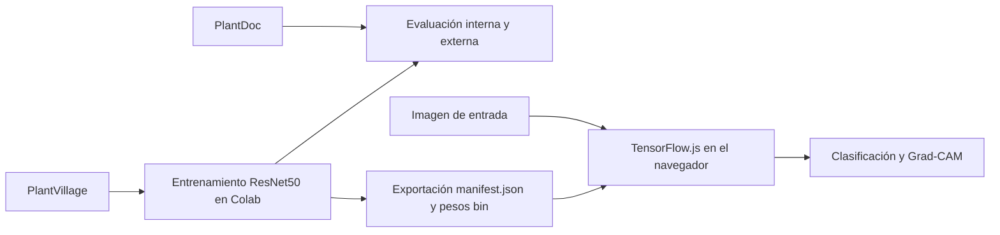

# PhytoVision AI

**Detección y clasificación de enfermedades en plantas mediante visión artificial: evaluación de la generalización en imágenes de diferentes condiciones.**

Proyecto académico de Inteligencia Artificial: Principios y Técnicas — Universidad Privada Antenor Orrego (2026).

## Objetivo

Desarrollar y evaluar un clasificador de imágenes de hojas de tomate, papa y maíz, y estudiar su capacidad de generalización desde PlantVillage (condiciones principalmente controladas) hacia PlantDoc (condiciones visuales más variadas).

## Tecnologías

- Python, TensorFlow y Keras: entrenamiento y evaluación en Google Colab.
- ResNet50 con transfer learning, global average pooling y clasificación Softmax de 14 categorías.
- HTML, CSS y JavaScript: interfaz de usuario.
- TensorFlow.js: inferencia local en el navegador (WebGL o CPU).
- Grad-CAM: visualización de regiones relevantes para la predicción.
- JSZip: lectura del modelo exportado en ZIP.
- GitHub Pages: opción de despliegue estático.

## Arquitectura



El modelo recibe imágenes de 224 × 224 × 3 y utiliza el preprocesamiento Caffe de ResNet50. La exportación personalizada `resnet50-bnfold-v1` fusiona Batch Normalization y utiliza pesos float16. La aplicación carga el manifiesto y los fragmentos de pesos para reconstruir la red.

## Funcionalidades

- Carga de fotografías y captura mediante cámara (sujeta a permisos del navegador).
- Clasificación entre las 14 categorías compatibles de los dos datasets.
- Presentación de la clase predicha y las cuatro puntuaciones principales.
- Visualización Grad-CAM: original, mapa de calor y superposición.
- Historial local de análisis y exportación CSV.

## Estructura propuesta del repositorio

```text
/
├── README.md
├── index.html
├── proyecto_plantas_corregido.ipynb
└── modelo_web/
    ├── manifest.json
    ├── pesos_01.bin
    ├── pesos_02.bin
    └── pesos_03.bin
```

Conservar todos los archivos de pesos enumerados en el manifiesto. Los nombres anteriores muestran la estructura de exportación esperada.

## Ejecución local

1. Descargar `modelo_web.zip` generado en la sección 7 del notebook.
2. Extraer su contenido en `modelo_web/`, junto a `index.html`.
3. Abrir la terminal en la carpeta raíz y ejecutar:

   ```bash
   python -m http.server 8000
   ```

4. Acceder a `http://localhost:8000` en el navegador.
5. Verificar el estado «Modelo Activo», cargar una imagen y seleccionar «Analizar Patología con ResNet50».

Alternativamente, abrir `index.html` y cargar `modelo_web.zip` mediante el botón de carga manual. Se requiere acceso a Internet para las bibliotecas servidas por CDN. No se necesita mantener Google Colab abierto durante la inferencia.

## Despliegue en GitHub Pages

Publicar `index.html` y `modelo_web/` en la misma carpeta de publicación. En Settings → Pages, seleccionar Deploy from a branch, la rama correspondiente y la carpeta de publicación (`/ (root)` si se usa la estructura anterior). El enlace definitivo se obtiene de GitHub Pages una vez publicado.

## Evaluación y pruebas

El protocolo del proyecto utiliza PlantVillage para entrenamiento y evaluación interna y PlantDoc exclusivamente para evaluación externa. Se consideran accuracy, precision, recall, F1-score y matriz de confusión. El informe académico registra los siguientes resultados preliminares (no necesariamente los del último modelo exportado):

| Evaluación | Accuracy |
| --- | ---: |
| Prueba interna PlantVillage | 95,29 % |
| Evaluación externa PlantDoc | 22,92 % |

Actualizar esta tabla con los resultados de la ejecución definitiva del notebook antes de la entrega. Para verificar el despliegue, comparar predicciones de Colab y de la web sobre las mismas imágenes etiquetadas de prueba, usando el mismo preprocesamiento y orden de clases.

## Alcance y limitaciones

- El modelo clasifica imágenes dentro de un conjunto cerrado de 14 categorías; solo tomate incluye una clase saludable. No permite confirmar el estado sano del maíz o de la papa.
- Una puntuación Softmax del 100 % no garantiza que la predicción sea correcta.
- Grad-CAM muestra regiones de influencia sobre la clasificación, no el porcentaje de tejido enfermo ni la severidad real.
- Los cambios de iluminación, fondo y perspectiva pueden reducir la exactitud en fotografías externas.
- Prototipo académico de apoyo a la interpretación de imágenes; no reemplaza la evaluación de un especialista.

## Datasets

- [PlantVillage](https://github.com/spMohanty/PlantVillage-Dataset).
- [PlantDoc](https://github.com/pratikkayal/PlantDoc-Dataset).

Consultar las condiciones de uso de los datasets antes de redistribuir imágenes o recursos derivados.
